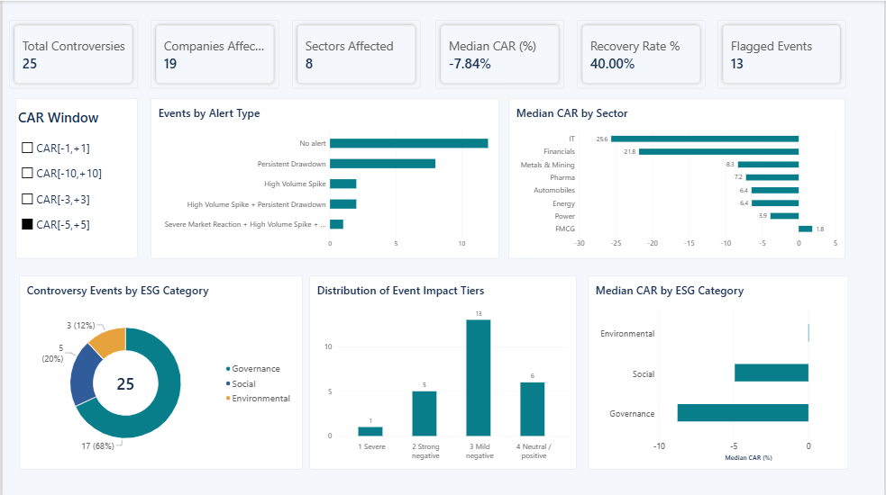
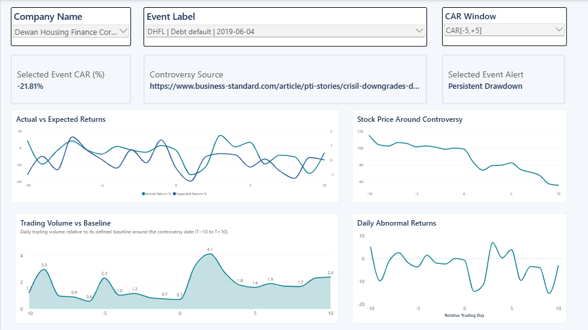
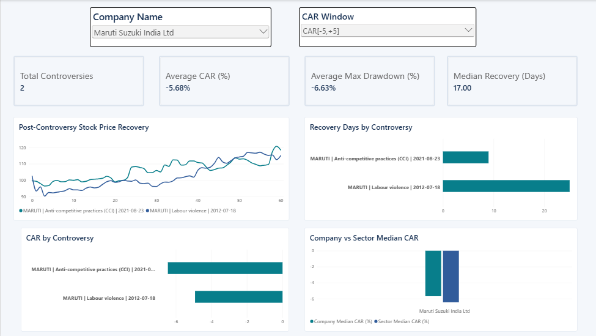

# ESG Market Risk Intelligence

## Power BI Dashboard

### 1. Overview Dashboard

Provides a high-level summary of ESG controversy market reactions, including abnormal returns, cumulative abnormal returns (CAR), volatility, and drawdowns.

### 2. Event-wise Analysis

Examines individual ESG controversies to compare market reactions and identify events associated with unusual abnormal returns, trading activity, and volatility.

### 3. Company-wise Analysis

Compares stock-market reactions across companies to identify differences in ESG-related market risk and financial impact.

See `HOW_TO_RUN.md` for how to execute and validate every phase locally.
